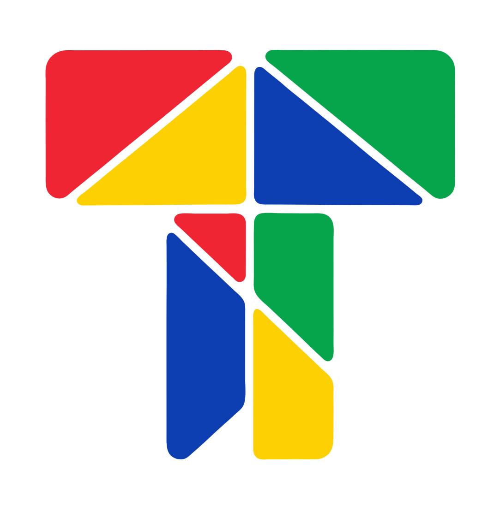

<p align="center"></p>

# Tess

**Tess** (from _tessera_, a single tile of a mosaic) is a self-hostable,
GraphQL-first headless CMS written in Rust, in the spirit of Strapi and
Hygraph: each content entry is a tile, and your sites and apps are the mosaic.

**Website:** [tessheadless.com](https://tessheadless.com) · **Documentation:** [tessheadless.com/docs](https://tessheadless.com/docs/) One binary runs as an HTTP server (Docker, VM, Kubernetes)
or as an AWS Lambda function.

- **Content models defined at runtime**: create content types through the API
  or the admin UI, and the GraphQL schema is regenerated from them on the fly
  (queries, filters, sorting, pagination, relations, mutations).
- **Draft / publish** for every entry, plus an optional **review workflow**
  per content type (submit → approve, or request changes).
- **Users and roles** (Owner, Admin, Contributor, Reviewer, Member), each user
  optionally limited to some content types; scoped **API tokens** for machines.
- **Pluggable storage**: PostgreSQL, MySQL, SQLite (one SeaQuery-based SQL
  backend), MongoDB, DynamoDB, RocksDB (embedded), or in-memory, all passing
  the same conformance suite.
- **Media library** on S3-compatible stores (Garage, MinIO, AWS S3, R2, ...) or
  the local filesystem, with direct presigned uploads.
- **Full-text search** with Typesense (pluggable engine).
- **Response cache** in Valkey, Redis, KeyDB or Dragonfly, shared by all
  instances and invalidated on every change.
- **Plugins**: sandboxed WebAssembly modules, installed and configured by admins
  at runtime (Extism; write them in Rust, Go, JS, ...).
- **Forms**: define contact, reservation or sign-up forms in the admin; front-ends
  post to `/api/forms/<slug>` and every submission starts n8n workflows.
- **Translations** (Tolgee-like): keys, namespaces, languages, review states,
  import/export (JSON, i18next, ARB, XLIFF, PO, properties, Android, Apple,
  YAML, CSV), live files at `/i18n/{format}/{file}` and publishing to Garage,
  AWS S3, Cloudflare R2, MinIO or Azure Blob.
- **Webhooks**: signed events (`entry.*`, `contentType.*`, `component.*`,
  `i18n.*`) with retries and a delivery log.
- **Workflows**: an embedded [n8n](https://n8n.io) editor with Tess nodes
  (_Tess Trigger_, _Tess_) in `integrations/n8n-nodes-tess`.
- **Opaque, expiring, encrypted ids** in the API; database ids never leave the
  server.
- **Admin UI** (Vike + React + daisyUI) served under `/admin/`, with a role-aware content manager.

```
               ┌──────────────── tess (axum | lambda_http) ────────────────────┐
 clients ──▶   │ /graphql /media/* /api/* /i18n/* /n8n/* /admin/ /health         │
               │        tess-graphql: dynamic schema, auth, opaque ids            │
               │        tess-core: models, validation, query language, hooks      │
               │   hooks ─▶ tess-search (Typesense) · tess-media · tess-plugins     │
               └───────┬──────────────────────┬────────────────────┬────────────┘
                 Storage trait          BlobStore trait       SearchEngine trait
     sql (postgres│mysql│sqlite)│     s3 (Garage…)│fs        typesense│memory
     mongodb│dynamodb│rocksdb│memory
```

| Crate                                       | Role                                                                                                                  |
| ------------------------------------------- | --------------------------------------------------------------------------------------------------------------------- |
| `crates/core`                               | domain model, validation, filter language + reference evaluator, `Storage` trait, `Hook` system, conformance test kit |
| `crates/storage-sql`                        | PostgreSQL / MySQL / SQLite backend (SeaQuery + sqlx)                                                                 |
| `crates/storage-{mongodb,dynamodb,rocksdb}` | other database backends                                                                                               |
| `crates/media`                              | `BlobStore` (S3 / filesystem), `Asset` content type, uploads                                                          |
| `crates/search`                             | `SearchEngine` (Typesense / memory), indexing hook                                                                    |
| `crates/cache`                              | `CacheStore` (Redis protocol: Valkey, Redis, KeyDB, Dragonfly / memory), response cache, invalidation hook            |
| `crates/plugins`                            | WebAssembly plugin runtime and manager                                                                                |
| `crates/i18n`                               | translations: keys, languages, review, file formats, delivery targets                                                 |
| `crates/webhooks`                           | outgoing webhooks: subscriptions, signing, retries, delivery log                                                      |
| `crates/graphql`                            | dynamic GraphQL schema, opaque id codec                                                                               |
| `crates/server`                             | HTTP/Lambda binary, configuration                                                                                     |
| `admin/`                                    | admin UI                                                                                                              |
| `examples/clients`, `examples/plugins`      | client and plugin examples                                                                                            |
| `integrations/n8n-nodes-tess`               | n8n community nodes (Tess Trigger, Tess)                                                                              |

## Quick start (Docker)

Without the sources: every release publishes Docker images
(`ghcr.io/tessheadless/tess`, amd64 and arm64), a Compose bundle and native
binaries for Linux, macOS and Windows. See [INSTALL.md](INSTALL.md).

From a checkout:

```sh
cp .env.example .env
# fill TESS_ADMIN_TOKEN, TESS_ID_SECRET, TESS_REF_SECRET with: openssl rand -hex 32
docker compose up --build
```

Open <http://localhost:8080/admin/> (sign in with `TESS_ADMIN_TOKEN`) or the
GraphiQL IDE at <http://localhost:8080/graphql>. By default data lives in an
embedded RocksDB database and local files, in the `tess-data` volume.

To run every optional service on your machine too (Garage for media,
Typesense, Valkey and n8n), use the `local` profile:

```sh
scripts/init-env.sh --local       # writes .env, secrets included
docker compose --profile local up --build
```

Other backends are compose profiles. Set the matching variables in `.env`:

```sh
docker compose --profile postgres up      # TESS_DATABASE=postgres
docker compose --profile mysql up         # TESS_DATABASE=mysql
docker compose --profile s3 up            # Garage, then: deploy/garage/init.sh <container> tess-media <key-id> <secret>
docker compose --profile search up        # TESS_SEARCH=typesense
docker compose --profile n8n up           # workflows: TESS_N8N_URL=http://n8n:5678, N8N_ENCRYPTION_KEY
```

### Without Docker

```sh
scripts/dev-server.sh                     # in-memory, random secrets, port 8080
source "${XDG_RUNTIME_DIR:-/tmp}/tess-dev.env" && scripts/seed.sh   # demo content
```

## GraphQL API

Creating a content type…

```graphql
mutation {
  createContentType(
    input: {
      apiId: "Post"
      fields: [
        { name: "title", type: TEXT, required: true } # max 80 chars by default
        { name: "body", type: MARKDOWN }
        { name: "status", type: ENUM, enumValues: ["NEWS", "TUTORIAL"] }
        { name: "author", type: RELATION, relationTarget: "Author" }
        { name: "cover", type: RELATION, relationTarget: "Asset" }
      ]
    }
  ) {
    apiId
  }
}
```

…immediately generates:

```graphql
post(id: ID!, stage: Stage = PUBLISHED): Post
posts(where: PostWhereInput, orderBy: [PostOrderByInput!], first: Int = 100, skip: Int = 0,
      stage: Stage = PUBLISHED): PostConnection!          # { total items }
searchPosts(query: String!, first: Int, skip: Int, stage: Stage): PostConnection!
createPost / updatePost / deletePost / publishPost / unpublishPost
```

Filters follow the `field_operator` convention: `title_contains`,
`views_gte`, `status_in`, `author` (by id), `createdAt_lt`, combinable with
`AND`, `OR`, `NOT`. Field types: `TEXT` (length bounds, regex format), `MARKDOWN` (HTML refused),
`INT`, `FLOAT`, `BOOLEAN`, `DATETIME`, `DATE`, `UUID`, `PASSWORD` (hashed,
write-only), `JSON`, `ENUM`, `RELATION` (single or `many`), `COMPONENT`
(reusable field groups, single or repeatable) and `DYNAMIC_ZONE` (a list
mixing components).

**Access**: anonymous requests read `PUBLISHED` content (disable with
`TESS_PUBLIC_READ=false`). Everything else needs `Authorization: Bearer
<token>`, where the token is a user session from `login`, an API token, or
the bootstrap `TESS_ADMIN_TOKEN`. Errors carry `extensions.code` (`FORBIDDEN`,
`BAD_USER_INPUT`, `NOT_FOUND`, `CONFLICT`, `ID_EXPIRED`, `PLUGIN_ERROR`, ...).

### Users, roles and review workflow

|                                                         | Owner | Admin | Contributor | Reviewer | Member |
| ------------------------------------------------------- | :---: | :---: | :---------: | :------: | :----: |
| Manage Owners                                           |   ✔   |       |             |          |        |
| Manage users, API tokens, content models, plugins       |   ✔   |   ✔   |             |          |        |
| Publish anything, bypass review                         |   ✔   |   ✔   |             |          |        |
| Approve / request changes (workflow types)              |   ✔   |   ✔   |             |    ✔     |        |
| Create and edit drafts, submit for review, upload media |   ✔   |   ✔   |      ✔      |          |        |
| Publish types **without** workflow                      |   ✔   |   ✔   |      ✔      |          |        |
| Read drafts and media                                   |   ✔   |   ✔   |      ✔      |    ✔     |   ✔    |

- **Scope:** a user's scope is a list of content types; empty means all.
  Contributors and Reviewers only act within their scope.
- **Deleting:** Contributors may only delete entries that were never published.
- **These rules are enforced in `tess-core`**, so every surface follows them:
  GraphQL, uploads, plugins.

**First run**: `setupRequired` is true until the first user exists.

1. Create the Owner with the bootstrap token, either from the admin UI's
   first-run screen or with `createUser`.
2. Sign in.
3. Remove `TESS_ADMIN_TOKEN` from the configuration.

```graphql
mutation {
  login(email: "ada@example.com", password: "…") {
    token
    expiresAt
    user {
      role
    }
  }
}
```

**Sessions** are signed with `TESS_SESSION_SECRET` and last `TESS_SESSION_TTL`
(default 12 h). They are stateless, so they work on Lambda. Each request
reloads the user, so these all revoke existing sessions immediately:
changing a user's role, scope or status, changing their password, or
`signOutEverywhere`. Passwords are hashed with Argon2id. After 10 failed
attempts, an account locks for 15 minutes.

**API tokens** (`createApiToken(name, role, scope, expiresInDays)`) are for
CI, front-end builds and webhooks. The token is shown once, and only its hash
is stored.

**Review workflow**: enable it per content type
(`createContentType(input: {…, workflow: true})`). Then:

```
DRAFT ──submitPostForReview──▶ IN_REVIEW ──approvePost──▶ PUBLISHED
  ▲                                │
  └──── CHANGES_REQUESTED ◀── requestChangesPost(comment)
```

- Editing an entry sets it back to `DRAFT`, so reviewers always approve
  exactly what gets published.
- Each entry exposes `workflowStatus`, `createdBy`, `updatedBy` and
  `history` (action, author, date, comment). Public readers get `null` for
  the people-related fields.
- Filter with `where: {workflowStatus: IN_REVIEW}`.
- Plugins receive the actions `submit`, `approve` and `requestChanges`, plus
  the `actor`.

**Ids**: `id` is an encrypted token that changes on every response and expires
after `TESS_ID_TTL` (default 24 h), so database ids are never exposed. Use
`ref`, a stable opaque value, as a cache or list key, and route by your own
fields (e.g. a `slug`). See [examples/clients](examples/clients).

### Media

- `POST /media/upload?fileName=cat.jpg` (admin token, raw body,
  `Content-Type`) stores the file and returns the asset.
- On S3-compatible stores, browsers can upload directly:
  `createAssetUpload(fileName, mimeType, size)` returns a presigned `PUT`;
  send the file, then call `confirmAssetUpload(id)`. This also avoids the 6 MB
  request limit on Lambda.
- `Asset.url` is the CDN URL (`TESS_MEDIA_PUBLIC_URL`), a presigned URL, or
  `/media/files/...` served by the CMS (with `nosniff` and a sandboxing CSP).
- Reference media from any content type with a `RELATION` to `Asset`.
  Deleting an asset deletes its file.

### Search

With `TESS_SEARCH=typesense`, an Admin enables search per content type in
**Admin → Search** and picks the indexed fields; the Typesense schema of each
field is generated from its type. Entries are then indexed on every change
(draft and published separately) and the type gets `search<Plural>`. Results
are loaded from the database, so they always match stored content.
`reindexSearch(apiId)` rebuilds an index.

### Plugins

Admins upload `.wasm` modules in **Admin → Plugins**, choose which content
types they apply to, give them JSON config, and optionally allow outgoing
HTTP to specific hosts. Plugins can transform or reject writes
(`before_write`) and react to them (`after_write`). They run sandboxed, with
no filesystem or environment, a timeout, and a memory cap. See
[examples/plugins](examples/plugins) for the contract and examples.

## Configuration

All configuration comes from environment variables; see
[`.env.example`](.env.example). Secrets (`TESS_ADMIN_TOKEN`, `TESS_ID_SECRET`,
`TESS_REF_SECRET`, database/S3/Typesense credentials) must come from the
environment or a secrets manager, never from files in the repository. The
server refuses to start without the id secrets.

| Variable                                                                       | Default               |                                                                                                  |
| ------------------------------------------------------------------------------ | --------------------- | ------------------------------------------------------------------------------------------------ |
| `TESS_DATABASE`                                                                | `memory`              | `postgres`, `mysql`, `sqlite`, `mongodb`, `dynamodb`, `rocksdb`, `memory`                        |
| `DATABASE_URL`                                                                 |                       | `postgres://…`, `mysql://…?ssl-mode=required` (MySQL 8 auth needs TLS), `sqlite:///data/tess.db` |
| `MONGODB_URL` / `DYNAMODB_TABLE` / `ROCKSDB_PATH`                              |                       | other backends                                                                                   |
| `TESS_MEDIA_STORE`                                                             | `fs` (`s3` on Lambda) | `TESS_S3_*`, `TESS_MEDIA_DIR`, `TESS_MEDIA_PUBLIC_URL`                                           |
| `TESS_SEARCH`                                                                  | `none`                | `typesense` (`TYPESENSE_URL`, `TYPESENSE_API_KEY`), `memory`                                     |
| `TESS_PLUGINS`                                                                 | `true`                | `TESS_PLUGIN_ALLOW_HTTP`, `TESS_PLUGIN_MAX_TIMEOUT_MS`, `TESS_PLUGIN_MAX_MEMORY_PAGES`           |
| `TESS_SCHEMA_REFRESH_SECS`                                                     | `10`                  | how fast other instances see model/plugin changes                                                |
| `TESS_PUBLIC_READ`, `TESS_GRAPHIQL`, `TESS_INTROSPECTION`, `TESS_CORS_ORIGINS` |                       | HTTP behavior                                                                                    |

Backends are cargo features of `tess-server` (`sql` for PostgreSQL/MySQL/SQLite,
`mongodb`, `dynamodb`, `rocksdb`, `s3`, `lambda`), so you can build smaller
binaries: `cargo build --release -p tess-server --no-default-features --features sql,s3`.

### SQL backend

The SQL backend uses three fixed tables (`tess_content_type`, `tess_entry`,
`tess_setting`). Each entry stores one JSON document per stage. Statements
are built with [SeaQuery](https://github.com/SeaQL/sea-query) for the engine
in use. Only reading typed values out of JSON is engine-specific (a small
`Dialect`). Comparisons are guarded by JSON type, and strings compare
bytewise on every engine, so results match the other backends exactly.
SQLite is a good single-container choice: embedded like RocksDB, but
filtering and sorting run in SQL.

## AWS Lambda

[`deploy/aws/template.yaml`](deploy/aws/template.yaml) (SAM) deploys the
function (arm64, `provided.al2023`, built with cargo-lambda) behind a
Function URL, with a DynamoDB table, a private S3 bucket and secrets from
Secrets Manager. The same binary detects the Lambda runtime automatically.

```sh
cd deploy/aws && sam build --beta-features && sam deploy --guided
```

RocksDB and the filesystem media store are rejected on Lambda (not
persistent), and so is SQLite. Postgres (RDS, Aurora, Neon) and MySQL work too.

To build the Lambda binary by hand:
`cargo lambda build --release --arm64 -p tess-server --no-default-features --features dynamodb,sql,lambda,s3`.
Some zig versions fail to link aarch64 with `unsupported linker arg:
--fix-cortex-a53-843419`. Either use a zig release that supports that
flag, or build `--x86-64` and set `Architectures: [x86_64]` in the template.
The x86_64 build has been checked with the AWS Lambda Runtime Interface
Emulator.

## Import and export

`tess-transfer` exports and imports content models and users as YAML or JSON,
through the API (works with every backend and deployment):

```sh
TESS_URL=http://localhost:8080 TESS_TOKEN=… tess-transfer export -o tess.yaml
TESS_URL=https://cms.example.com TESS_TOKEN=… tess-transfer import tess.yaml --dry-run
```

See the [import & export guide](https://tessheadless.com/docs/devops/import-export).

## Development

```sh
scripts/test-all.sh                  # all tests, incl. real Postgres/MySQL/MongoDB/DynamoDB/Garage/Typesense in containers
NO_CONTAINERS=1 scripts/test-all.sh  # without services
cd admin && npm install && npm run dev   # admin UI, proxies the API on :8080
```

Every storage backend runs the same conformance suite
(`tess_core::testkit`): each query is checked against the reference in-memory
evaluator, so filters, sorting and pagination behave identically everywhere.

## Current limitations

- **Sign-in is email and password only**. OIDC/SSO is planned for the
  Enterprise version.
- **No uniqueness lock on emails**: the email check isn't atomic, so two
  admins creating the same email at the same instant could both succeed.
- **Key-value backends filter in memory**: DynamoDB and RocksDB read a
  content type's whole partition for list queries. That's fine for thousands
  of entries per type; for much more, use a SQL engine or MongoDB, or put a
  cache or CDN in front.
- **SQL filters use no indexes yet**: they evaluate JSON expressions per row
  within a content type. Generated per-field expression indexes would speed
  up large tables.
- **The in-memory search engine** (`TESS_SEARCH=memory`) loses its index on
  restart (`reindexSearch` rebuilds it); Typesense persists.
- **No constraints yet**: no unique fields, no renaming of content types, no
  migration of data when a field's type changes. Old values are hidden
  rather than converted.
- **Relations are resolved per entry** (no DataLoader batching yet).
- **Search indexing is synchronous**: changing a content type re-indexes it
  inside the request.
- **Lambda secrets**: the SAM template resolves secrets into environment
  variables. Anyone with `lambda:GetFunctionConfiguration` can read them, so
  restrict that permission, or switch to fetching secrets at runtime.

## Versions and releases

The version is in [`VERSION`](VERSION) (`vX.Y.Z`). `scripts/version.sh` sets it
in every sub-project (crates, admin, website, docs, n8n nodes) and checks them
(`--check`). Each `vX.Y.Z` release is built by the release workflow, and its
changes are on the [releases page](https://github.com/tessheadless/core/releases)
(see [CHANGELOG.md](CHANGELOG.md)).

## Documentation

The documentation is published at [tessheadless.com/docs](https://tessheadless.com/docs/).
Its source is in [`docs/`](docs) (Docusaurus): `cd docs && npm install && npm start`.

## License

Tess uses a hybrid license: the **Community** edition is for personal use, and
the **Enterprise** edition is for commercial use. Enterprise adds advanced
features, plugins maintained by the Tess Dev Team, and hosting solutions. See
[LICENSE.md](LICENSE.md), currently a draft pending legal review, and
[tessheadless.com](https://tessheadless.com).

Copyright © 2026 Tess Dev Team
